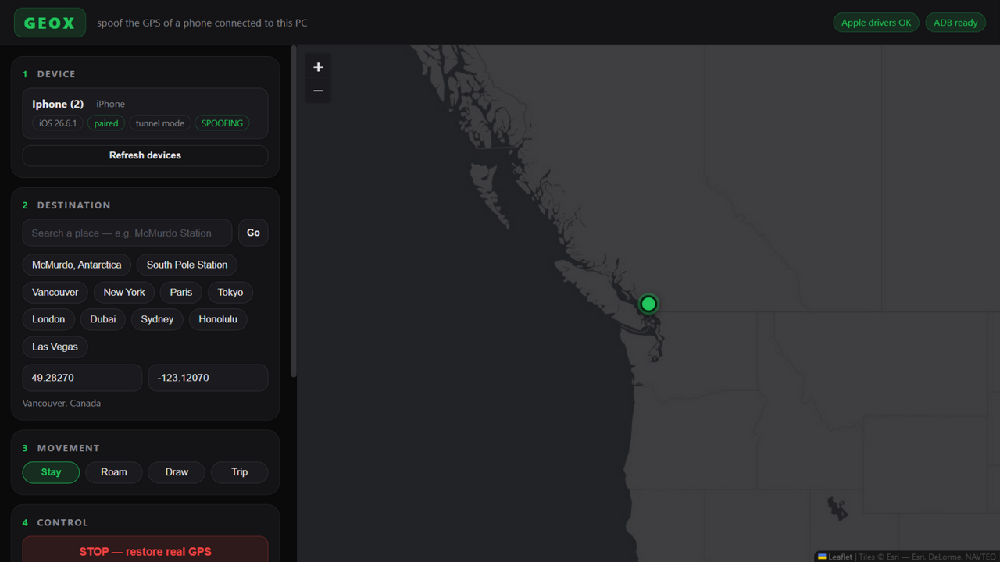

# Geox

**Change the GPS location of a phone connected to your PC or over Wi-Fi, and every app on it believes it.**
Plug an iPhone or Android into the computer with a USB cable or connect wirelessly over Wi-Fi, pick any spot on a map, and the phone reports that location at operating-system level.

[](https://github.com/arx33d/Geox/actions/workflows/ci.yml)
[](https://github.com/arx33d/Geox/actions/workflows/codeql.yml)
[](https://github.com/arx33d/Geox/releases)
[](https://www.python.org/)
[](LICENSE)
[](https://github.com/arx33d/Geox)


Plug an iPhone or Android into the computer with a USB cable or connect wirelessly over Wi-Fi, pick any spot on a map, and the phone reports that location at operating-system level: Find My, Snap Map, Google Maps, WhatsApp live location, everything.

You are in Vancouver. Everyone checking your location sees you at McMurdo Station, Antarctica.



## Features

- **Map picker.** Search any place, click the map, drag the pin, or use presets (McMurdo and the South Pole included). Dark UI, no clutter.
- **Trip mode.** The location follows a real itinerary: car, bike, or walking routes on actual streets, at realistic speed, arriving and parking at the destination. Can parse a pasted **Google Maps link** (route links, pinned places, `@lat,lng` views).
- **Roam mode.** Drifts between random points inside a radius at walking speed, so your pin looks alive instead of frozen.
- **Draw mode.** Click waypoints on the map and travel between them at a speed you choose.
- **Wireless Wi-Fi mode.** Control phone movement, live trips, and roam completely cable-free over local Wi-Fi without needing a USB cable.
- **Unplug & Go (Location Lock).** Lock a location on your phone and unplug the cable. The device persistently retains the mock location at operating-system level wherever you take it.
- **Phone Remote Web App.** Control and change your location directly from your phone! Click 'Phone Remote' in the header, scan the QR code with your camera or open `http://<pc-ip>:7876/remote` in Safari/Chrome. Features a touch-enabled map, address search, presets, and a real-time virtual joystick D-pad.
- **Standalone Android On-Phone Control.** Android users can also change their location directly on the device with zero PC connection using Geox Bridge's built-in 'Set Location On-Phone' picker.
- **iPhone, iOS 15 through current.** Uses Apple's own Instruments location-simulation channel (the mechanism Xcode uses), including the iOS 17+ tunnel. Nothing is installed on the phone.
- **Android.** Official mock-location provider via a tiny companion app, driven over ADB.
- **Self-installing.** `run_geox.bat` needs no Python and no admin rights: the first run downloads everything automatically. Zip the folder and share it as-is.
- **Self-healing sessions.** The fake fix is re-asserted every second, tunnel blips auto-reconnect, and a phone that drops off USB is waited for and resumed.

## Which File Do I Run?

If you downloaded or extracted this folder:

**Double-click `START_GEOX.bat` or `Geox.exe`**.

That is all you need to run Geox. You do not need to install anything or run setup.

### File Guide:

| File | Type | When to use |
|---|---|---|
| **`START_GEOX.bat`** | Primary Launcher | **Double-click this to launch Geox immediately** |
| **`Geox.exe`** | Native Application | Direct executable launcher for GUI & CLI |
| `run_geox.bat` | Batch Script | Alternative launcher if `.exe` is blocked by Windows policy |
| `GeoxSetup.exe` | Windows Installer | Only if you want to install Geox to Start Menu and Desktop shortcuts |
| `run_geox.sh` | Shell Script | For Linux and macOS users only |

---

## Step-by-Step Guide: How to Use Geox (Anyone Can Follow)

Follow these simple steps from start to finish. No technical experience required.

### Step 1: First-Time Phone Setup (2 Minutes)

#### For iPhone:
1. **Apple Drivers**: Install the free **Apple Devices** app from the Microsoft Store (or iTunes from Apple). Geox launches this service automatically.
2. **Connect Phone**: Plug your iPhone into your PC with a USB cable.
3. **Trust This PC**: Unlock your iPhone screen and tap **Trust** when prompted, then enter your passcode.
4. **Developer Mode (iOS 16 & newer)**:
   - On your iPhone, open **Settings -> Privacy & Security -> Developer Mode**.
   - Toggle it **ON**. Your iPhone will ask to restart.
   - After restarting, unlock the phone and tap **Turn On** when prompted.
   *(If the switch is not visible in Settings yet, Geox will reveal it automatically when you click Start).*

#### For Android:
1. **Enable Developer Options**: Open **Settings -> About Phone**, then tap **Build Number** 7 times.
2. **Enable USB Debugging**: Open **Settings -> Developer Options**, and turn **USB Debugging** to **ON**.
3. **Connect Phone**: Plug your Android into your PC with a USB cable and tap **Allow** on the phone screen.
4. **Install Bridge**: In the Geox web interface, click **Install ADB** and **Setup Bridge**. Geox configures permissions automatically.

---

### Step 2: Starting Geox
1. Double-click **`START_GEOX.bat`** (or **`Geox.exe`**).
2. The Geox control window will open and automatically launch the Web App in your browser at `http://localhost:7876`.
3. Keep the launcher window open while using Geox.

---

### Step 3: Spoofing Your Location (Standard Mode)
1. **Pick Device (Step 1)**: Click on your phone in the left list (e.g., `iPhone` or your Android name).
2. **Choose Destination (Step 2)**:
   - Type an address, landmark, or city in the search bar and click **Go**.
   - Or click anywhere on the world map and drag the green pin.
   - Or pick a preset (e.g., McMurdo Station, Antarctica).
3. **Choose Movement (Step 3)**:
   - **Stay**: Holds your phone locked at that exact spot.
   - **Roam**: Simulates natural walking movement around the area so your pin looks alive.
   - **Trip**: Follows real road directions with realistic car, bike, or walking speeds.
4. **Start**: Click **START SPOOFING**.
   - Open Apple Maps, Google Maps, Find My, or Snapchat on your phone to confirm your location changed!
5. **Stop**: Click the red **STOP** button at any time to restore your phone to real GPS.

---

### Step 4: Going Cable-Free (Wi-Fi Mode)
You do not need to keep your phone plugged into USB:
1. While connected via USB, make sure your phone and PC are on the **same Wi-Fi network**.
2. Click **Go Wireless** (or **Wireless Mode** -> **Enable Cable-Free Wi-Fi & Unplug**).
3. Once paired, you can **unplug the USB cable**.
4. Your phone will now show a `Wi-Fi` badge in Geox. You can change locations, roam, and run trips completely wireless.

---

### Step 5: Unplug & Go (Leave the House with Fake GPS on 4G/5G)
Want to leave the house, go out in the real world, and keep your phone locked at the fake location?
1. Connect your phone (via USB or Wi-Fi).
2. Choose your destination on the map.
3. Check the box **"Unplug & Go (Lock Location)"**.
4. Click **START SPOOFING**.
5. The status badge will show **`LOCKED (UNPLUGGED)`**.
6. **Unplug your phone, turn off Wi-Fi/Bluetooth, and take your phone anywhere on cellular data (4G/5G)**.
   - Every app on your phone (Find My, Life360, Snapchat, Tinder, Maps) will show the fake location.
   - The fake location stays active everywhere you go.
7. **To return to real GPS**: Simply restart your phone, or reconnect to Geox and click **STOP**.

---

### Step 6: Control from Your Phone Screen (Geox Remote)
You can change your fake location directly from your phone's touchscreen without touching the PC:
1. In the Geox desktop app header, click **Phone Remote**.
2. A QR code and local URL (e.g., `http://192.168.x.x:7876/remote`) will appear.
3. Open your phone camera, scan the QR code, and open the page in Safari or Chrome.
4. *(Optional)* Tap **Share -> Add to Home Screen** on iPhone, or **Install App** on Android to use it like a full-screen mobile app.
5. Tap anywhere on the mobile map, search places, or use the on-screen joystick arrows to walk around in real time.

---

### Other Ways to Install:

- **One-Click PowerShell Install**: Open PowerShell and run `irm https://raw.githubusercontent.com/arx33d/Geox/main/install.ps1 | iex`
- **Standalone Installer**: Download `GeoxSetup.exe` from releases to install without extracting the folder.

### Option B: Command Line (CLI)
You can run Geox directly from your terminal or command prompt (`cmd.exe`, PowerShell, or bash):

```bat
# Spoof location with a Google Maps URL (Stay mode):
geox --location "https://www.google.com/maps/place/Toronto,+ON/@43.7164673,-79.6563003,..." --movement stay

# Spoof location with Roam mode (radius 120m, speed 4.5 km/h):
geox --location "Toronto, ON" --movement roam 120 4.5

# Spoof directly using presets:
geox --preset mcmurdo --movement roam 200 5

# Plan and drive a realistic trip:
geox --from "Vancouver" --to "Seattle" --profile car --speed-factor 1.5

# Wireless Wi-Fi and Unplug & Go:
geox --wireless                       # Switch plugged USB device to wireless Wi-Fi mode
geox --connect-wifi 192.168.1.50:5555  # Connect directly to a phone over Wi-Fi
geox --location "Paris, France" --lock # Lock location persistently and unplug cable

# Device management and controls:
geox --devices          # List connected phones
geox --stop             # Stop spoofing & restore real GPS
geox --status           # Check active spoofing sessions
geox server             # Start the browser UI
```

The terminal window is the live connection to the phone, so keep it open.
Pressing **Ctrl+C** (or the red **STOP** button in Web UI) restores the real GPS instantly.

### If Windows blocks the file

That's Windows SmartScreen reacting to the "downloaded from the internet" marker, not a virus. Two ways past it:

- **Before extracting**: right-click the downloaded zip, choose **Properties**, tick **Unblock**, then extract. Nothing gets blocked afterwards.
- **On first run**: when the blue "Windows protected your PC" screen appears, click **More info**, then **Run anyway**.

The `run_geox.sh` file is only for macOS, Linux and Git Bash users. Windows users never need it, and double-clicking it on Windows does nothing, which is normal.

## Requirements

| Platform | Needed once |
|---|---|
| **iPhone** | Apple's USB drivers (the *Apple Devices* app from the Microsoft Store, or iTunes; Geox starts the service for you), *Trust this computer*, Developer Mode ON (Geox reveals the switch and walks you through it). |
| **Android** | USB debugging enabled; build the `Geox Bridge` app once from [`android-bridge/`](android-bridge) (about 10 minutes with Android Studio), then press *Setup bridge* and Geox installs and configures it by itself |

## How it works

On **iPhone**, Geox opens Apple's hidden developer channel for location simulation over the USB pairing. The OS then reports the simulated fix as if it were real GPS, which is why Find My and Snap Map show the fake place: they ask the OS where the device is, and the OS answers with the spoof.

On **Android**, the Geox Bridge companion app receives coordinates over ADB and feeds them into the OS as mock GPS fixes.

**Trip mode** queries OpenStreetMap routers (free, no API key) for real road geometry, then travels the route at the route's real average speed.

The long version (architecture, setup walkthroughs, what can still give you away, troubleshooting, FAQ) is in **[EXPLANATION.md](EXPLANATION.md)**.

## Documentation & Community

- [EXPLANATION.md](EXPLANATION.md): Complete guide covering setup, internals, realism tips, troubleshooting, and FAQ.
- [CONTRIBUTING.md](CONTRIBUTING.md): Developer setup, coding standards, Conventional Commits, and test guidelines.
- [SECURITY.md](SECURITY.md): Vulnerability reporting procedures, response SLA, and security design.
- [ROADMAP.md](ROADMAP.md): Project roadmap, upcoming features, and milestones.
- [android-bridge/README.md](android-bridge/README.md): Building and deploying the Android companion bridge.

## Disclaimer

Geox changes the location of **your own device**. It does not access, hack, or monitor anyone else. Location spoofing is legal in most places, but how you use it may not be. Faking attendance, cheating delivery or ride apps, or deceiving people whose safety depends on your location can be fraud, a terms-of-service violation, or worse. Provided as-is, for personal and lawful use. You are responsible for what you do with it.

## License

Geox is free to use, modify, and redistribute, **but not to sell**. It's licensed under MIT with a Commons Clause addendum: anyone may use it, change it, and share it for free, but nobody may sell the software itself or charge for it. Donations and free distribution are fine. See [LICENSE](LICENSE).
